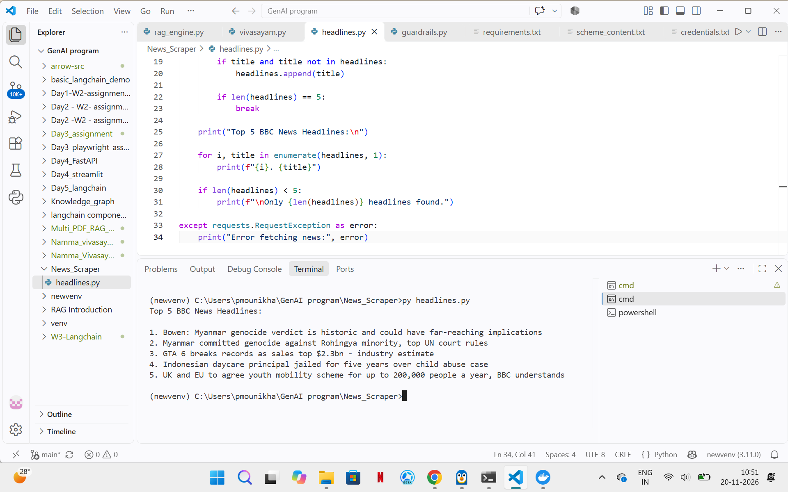

# BBC News Headlines Scraper

## Project Overview

This project is a simple Python web scraping application that extracts and displays the top 5 news headlines from the BBC News website.

It uses the Requests library to fetch webpage content and BeautifulSoup to extract headlines from HTML.

This project was developed as part of the Week 3 – Day 5 Python and AI learning assignment.

## Technologies Used

- Python 3.11
- Requests
- BeautifulSoup4
- HTML and CSS Selectors
- Visual Studio Code

## Features

- Fetches the latest available headlines from BBC News.
- Extracts headlines using BeautifulSoup.
- Displays 5 numbered headlines in the terminal.
- Removes duplicate and empty headlines.
- Handles HTTP request errors.
- Handles cases where fewer than 5 headlines are found.
- Uses a User-Agent header when requesting the webpage.

## Project Structure

```text
News_Scraper/
│
├── headlines.py
├── headlines_output.png
├── .gitignore
└── README.md
```

## Installation

**Step 1: Clone the repository**

```bash
git clone https://github.com/Mouni-0909/News_Scraper.git
```

**Step 2: Navigate to the project folder**

```bash
cd News_Scraper
```

**Step 3: Install the required libraries**

```bash
python -m pip install requests beautifulsoup4
```

## How to Run

Open Command Prompt (CMD) in the project folder and execute:

```bash
python headlines.py
```

## Sample Output

```text
Top 5 BBC News Headlines:

1. First BBC news headline
2. Second BBC news headline
3. Third BBC news headline
4. Fourth BBC news headline
5. Fifth BBC news headline
```

*Note: The actual headlines change depending on the news published on the BBC website.*

## How It Works

1. Sends an HTTP request to `https://www.bbc.com/news`.
2. Checks the HTTP response status.
3. Parses the webpage HTML using BeautifulSoup.
4. Finds headlines using the CSS selector `h2[data-testid="card-headline"]`.
5. Removes empty and duplicate headlines.
6. Prints the first 5 unique headlines in the terminal.

## Output Screenshot

The terminal output screenshot is available in the repository.



## Key Learnings

Through this assignment, I learned:

- How to fetch webpage content using Python Requests.
- How to inspect HTML elements using Chrome Developer Tools.
- How to identify and use CSS selectors.
- How to extract information using BeautifulSoup.
- How to handle duplicate data and HTTP errors.
- How to upload a Python project to GitHub.

## Limitations

- The scraper depends on the BBC website's HTML structure.
- Changes to the headline selector may require updating the Python script.
- Websites that load content dynamically using JavaScript may require a different scraping approach.

## GitHub Repository

https://github.com/Mouni-0909/News_Scraper

## Conclusion

This assignment helped me understand the fundamentals of web scraping using Python. I gained practical experience in fetching webpage data, parsing HTML, extracting useful information, and displaying structured results in the terminal."# News_Scraper" 
